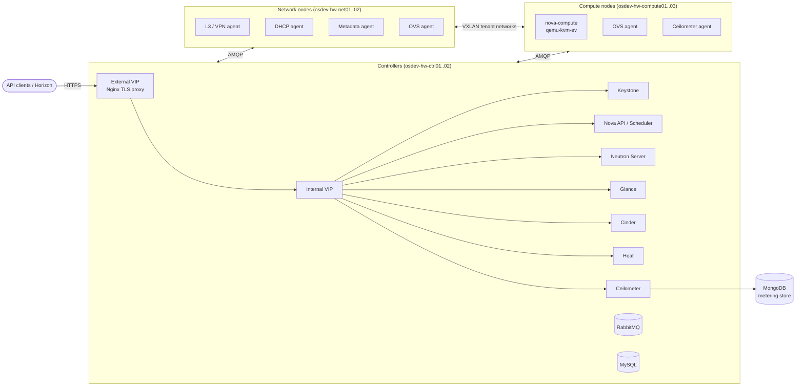

# ostack — Bare-Metal OpenStack with Ansible

Ansible playbooks that take a fleet of freshly installed CentOS/RHEL 7 servers and turn them into a working, multi-node **OpenStack** cloud, with a public HTTPS API, a highly available controller pair, VXLAN tenant networking and metering.

I wrote this in 2016 to stand up the hardware dev region (`Dev1`) of a public cloud provider. It's an end-to-end infrastructure-as-code project: OS hardening, firewalling, message bus, databases, identity, service catalog, compute, networking, storage, orchestration and telemetry are all driven from a single `ansible-playbook` run.


---

## Highlights

- **Full OpenStack stack, from scratch:** Keystone, Nova, Neutron (ML2 + Open vSwitch, VXLAN), Glance, Cinder, Heat and Ceilometer, plus their dependencies: MySQL, RabbitMQ and MongoDB.
- **Active/passive controllers on a floating VIP:** the first host in the `controller` group is treated as master (`is_master_controller`). It holds the internal and external virtual IPs, runs DB migrations and owns singleton services. The standby is configured identically but keeps those services stopped.
- **TLS-terminating API gateway:** each OpenStack API is published on the external VIP through a templated Nginx reverse proxy (`nginx_endpoint.conf.j2`) and proxied to the service on the internal VIP. Large-upload buffering is tuned for 25 GB image uploads.
- **Data-driven configuration:** service settings live in `group_vars` as `[section, option, value]` lists and are applied by one generic module. Adding a config option means adding one line of YAML.
- **Custom Ansible modules written in Python** (see [below](#custom-ansible-modules)), covering things Ansible didn't do well at the time: idempotent INI editing, MongoDB config, and Keystone v3 domains/roles.
- **Secrets kept out of the repo in plain text:** every password, token and TLS key comes from an **Ansible Vault**, mapped onto readable variable names in `group_vars/all/vars.yml`.
- **Security baseline on every host:** firewalld replaced by managed iptables rules, trusted interfaces on the management/data/storage VLANs, SSH restricted to an allow-list, NTP and timezone pinned, SELinux contexts restored.
- **Idempotent and re-runnable:** tasks check state before acting (VIPs, MySQL root password, MongoDB admin login) and every task is tagged, so you can run a single component without touching anything else.

---

## Architecture



Each host is wired into separate VLANs for **public infrastructure**, **management**, **data** (VXLAN tunnels) and **storage** traffic. Interfaces are mapped per environment through the `nics` variable.

---

## Repository layout

```
.
├── site.yml                 # Entry point: controller → network → compute
├── controller.yml           # Per-tier playbooks (each = common + tier role)
├── network.yml
├── compute.yml
├── mongo.yml
│
├── inventory/dev1           # Host groups for the Dev1 region
├── group_vars/
│   ├── all/                 # Defaults shared by every region, one file per service
│   │   ├── vars.yml         #   endpoints, service catalog, RabbitMQ, TLS paths
│   │   ├── nova_vars.yml, neutron_vars.yml, cinder_vars.yml, heat_vars.yml, ...
│   │   └── vault.yml        #   🔒 encrypted secrets
│   └── dev1/                # Region-specific overrides (VIPs, DNS, region name)
├── host_vars/               # Per-host NIC mapping
│
├── common/                  # Base OS: packages, RDO repo, NTP, iptables
├── controller/              # VIPs, TLS, MySQL, RabbitMQ, Nginx, all API services
├── network/                 # Neutron L3 / DHCP / metadata / VPN agents
├── compute/                 # KVM, nova-compute, OVS agent, Ceilometer agent
├── mongo/                   # MongoDB with auth for Ceilometer
│
├── library/                 # Custom Ansible modules (Python)
└── utils/                   # Operational one-off playbooks
```

---

## How a controller is built

`controller/tasks/main.yml` runs in dependency order:

| Step | What happens |
|------|--------------|
| 1. Network | Enables `ip_nonlocal_bind` and brings up the internal and external VIPs on the master controller |
| 2. TLS | Pushes the vaulted certificate and key with the correct SELinux type |
| 3. RabbitMQ | Installs a pinned RabbitMQ, creates the `os` vhost and the service and admin users |
| 4. MySQL | Installs and secures MySQL: sets the root password on every host binding, drops anonymous users and the test DB |
| 5. Keystone | Bootstraps tenants and users, then registers **every** service and endpoint in the catalog from a single `openstack_services` list |
| 6. Nginx | Generates one TLS reverse-proxy vhost per API port |
| 7. Services | Glance → Nova → Neutron → Cinder → Ceilometer → Heat: install, configure, create DB, `db_sync`, start |

Heat setup uses the **Keystone v3** API to create a dedicated `heat_domain_admin` domain and stack-admin user. It feeds the generated domain ID back into `heat.conf`.

---

## Custom Ansible modules

| Module | Purpose |
|--------|---------|
| [`setosconf`](library/setosconf.py) | Idempotently sets or removes an option in any OpenStack INI file via `crudini`, and reports `changed` correctly. Every service role uses it. |
| [`setmongoconf`](library/setmongoconf.py) | Parses and rewrites `/etc/mongod.conf` key/value pairs while leaving comments and unknown keys untouched. |
| [`keystone_service`](library/keystone_service) | Manages a Keystone service plus its public, internal and admin endpoints per region. |
| [`os_user_cn`](library/os_user_cn.py) | Patched fork of upstream `os_user`, used to create the Heat stack-admin user inside a Keystone v3 domain. |
| [`os_keystone_domain`](library/os_keystone_domain.py), [`os_user_role`](library/os_user_role.py) | Upstream modules backported ahead of the Ansible release that shipped them. |

Example: the whole Neutron network-node config is just data.

```yaml
- name: Set DHCP agent ini
  setosconf:
    dest: "{{dhcp_agent_ini}}"
    section: "{{item.0}}"
    option: "{{item.1}}"
    value: "{{item.2}}"
  with_nested:
    - neutron_node_dhcp_vals
```

---

## Usage

**Requirements:** Ansible 2.x on the control machine, and CentOS/RHEL 7 targets reachable over SSH as root.

```bash
# Deploy the whole region
ansible-playbook -i inventory/dev1 site.yml --vault-password-file .vault_pass.txt

# Deploy a single tier
ansible-playbook -i inventory/dev1 compute.yml --vault-password-file .vault_pass.txt

# Re-run just one component, e.g. Heat on the controllers
ansible-playbook -i inventory/dev1 controller.yml --tags controller_heat --vault-password-file .vault_pass.txt

# Ceilometer's MongoDB backend
ansible-playbook -i inventory/dev1 mongo.yml --vault-password-file .vault_pass.txt
```

To add a new region, create `inventory/<region>` and `group_vars/<region>/` with that region's VIPs, `server_name`, `region` and NIC mapping. All service definitions are inherited from `group_vars/all`.

---

## Status

This is a historical project from 2016. It targets the OpenStack releases RDO shipped at the time, uses Ansible 2.0-era syntax (`include:`, bare `with_items` variables) and Python 2. I'm keeping it as a portfolio piece that shows how I approach infrastructure automation, not as a maintained deployment tool. For a modern deployment, look at Kolla-Ansible or OpenStack-Ansible.

## Author

**Dmitri Kozhevin**: [github.com/dmitriko](https://github.com/dmitriko)
